<picture>
  <source media="(prefers-color-scheme: dark)" srcset="docs/assets/wordmark-dark.svg">
  
</picture>

**English** · [日本語](README.ja.md)

**Create, jump between, and remove git worktrees. All with `hop`.**

`nuthatch` is a zero-setup git worktree manager for humans and AI coding agents. Its one command, `hop`, needs no config and no state files. [Website](https://www.sijis.me/en/projects/nuthatch)

<table>
  <tr>
    <td align="center" valign="top" width="33%">
      <br>
      <b>Create</b><br>
      <sub>The branch and its worktree, on the spot.</sub>
    </td>
    <td align="center" valign="top" width="33%">
      <br>
      <b>Jump</b><br>
      <sub><code>hop</code> to pick, <code>hop -</code> to go back.</sub>
    </td>
    <td align="center" valign="top" width="33%">
      <br>
      <b>Remove</b><br>
      <sub>One at a time, or clean up what's merged.</sub>
    </td>
  </tr>
</table>

## Install

```sh
curl -fsSL https://raw.githubusercontent.com/n-seiji/nuthatch/main/install.sh | sh
```

Then add this to `~/.zshrc` so `hop` can `cd` for you:

```sh
eval "$(hop init zsh)"
```

For npm, mise, Linux arm64, verifying binaries, and updating, see the [guide](docs/guide.md#install).

## Usage

| Command | What it does |
|---|---|
| `hop` | Pick a worktree or branch interactively and `cd` into it |
| `hop <branch>` | `cd` into the branch's worktree |
| `hop <branch> --create` | Create the worktree if it is missing |
| `hop -` | `cd` back to the previous worktree |
| `hop root` | `cd` into the root clone |
| `hop ls [--json]` | List worktrees (dirty, ahead/behind, kind) |
| `hop rm <branch>` | Remove a worktree. The branch is kept |
| `hop clean` | Find and remove garbage worktrees (managed only by default) |
| `hop --update` | Replace a standalone binary with the latest release |

The [guide](docs/guide.md#usage) covers the picker and its keys, `hop root <branch>`, and the rest.

## Safe by default

- `hop rm` refuses a dirty worktree unless you pass `--force`. `hop clean` and `hop root` never touch one.
- A worktree that git reports as locked is never removed, even with `--force`.
- Deleting an external worktree (one not under `_worktree/<repo>/`) from the picker asks y/N. Ctrl+X always asks.
- By default, `hop clean` only picks worktrees that hop manages. External ones need `--ext`.
- `hop rm` keeps the branch.

## For AI coding agents

Every command can complete non-interactively. `--json` works everywhere, paths go to stdout, and logs go to stderr. The repo ships the [`using-hop`](plugins/hop/skills/using-hop/SKILL.md) skill as a plugin. It teaches agents to drive `hop` safely.

```sh
# Claude Code
/plugin marketplace add n-seiji/nuthatch
/plugin install hop@nuthatch

# Codex
codex plugin marketplace add n-seiji/nuthatch
codex plugin install hop
```

## More

- [Website](https://www.sijis.me/en/projects/nuthatch)
- [Guide](docs/guide.md): usage, picker, install, updating, troubleshooting
- [docs/design.md](docs/design.md): the design document
- [AGENTS.md](AGENTS.md): guide for coding agents working on this repo
- [LICENSE](LICENSE): GPL-3.0
